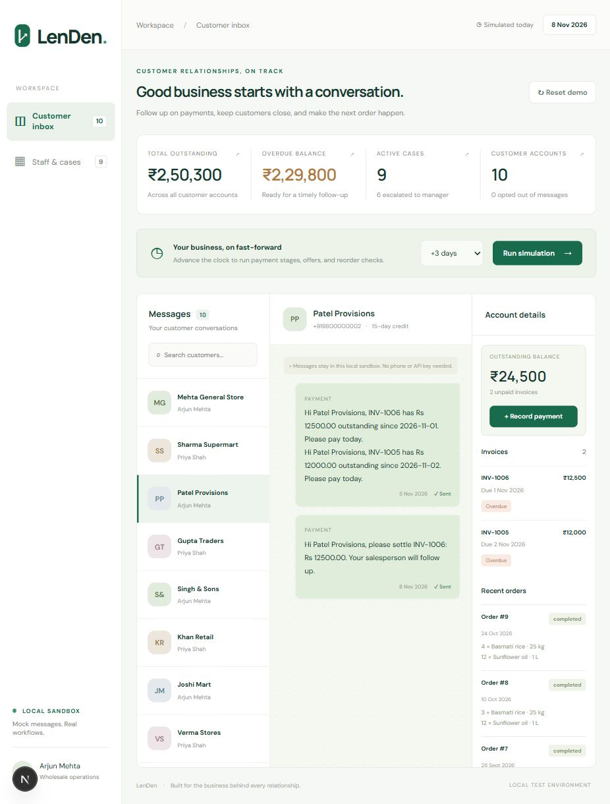
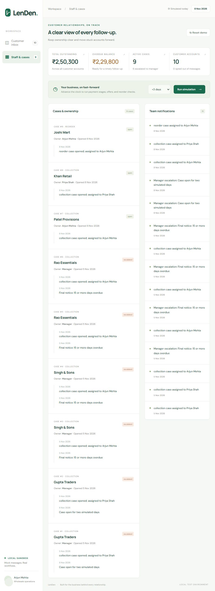

# Browser walkthrough

Start the API and UI using [README.md](README.md). All data and actions are fictional and local. Default URL: http://localhost:3000. Screenshots below were captured from the running app, with alternative local ports used during verification.

## 1. Seed and run today

Click **Reset demo**, choose **Run today** in the clock menu, then **Run simulation**. The date stays 5 November 2026. Customer balances include unpaid and partially paid invoices. Open **Patel Provisions**: a single chat bubble lists INV-1005 and INV-1006, both already overdue. Click the message's **Sent** status to simulate Delivered, then Read. Running today again must not send a duplicate.



## 2. Partial payment and the next stage

With Patel selected, click **Record payment**, select **INV-1006**, enter **5000**, and save. Its remaining amount becomes **Rs 7500**. Choose **+7 days** and run the simulation. The next message uses the remaining balance; it never asks for Rs 12500 again. The account total also drops by Rs 5000.

## 3. Promise, dispute and STOP

Reset between these independent examples:

- **Promise:** run today, select Patel, click **PROMISE +3 days** and **Send**. Open Staff & cases to see waiting cases. Advance one day: collections for Patel stay paused. Advance another two days: unpaid invoices resume at a firmer stage.
- **Dispute:** select Patel, click **DISPUTE**, then **Send**. Staff cases show dispute and salesperson ownership. Advance seven days: collection messages remain paused; the case can escalate internally.
- **STOP:** select any customer, click **STOP**, then **Send**. The customer is marked opted out and staff get a notification. Advance fifteen days: that customer receives no more outgoing messages.
- **PAID:** sends a verification notification without zeroing the invoice. Use Record payment to settle it; its case then resolves.

## 4. Staff ownership and escalation

Reset, run today and open **Staff & cases**. Gupta Traders' firm-stage invoices have salesperson cases; Singh & Sons and Rao Essentials are at final notice with Manager ownership. Advance three days: the open Gupta cases escalate, with dated timeline events and team notifications. Recording the full remaining payment for an invoice resolves its case without creating another case.



## 5. Reorder and win-back

- Reset and run today. **Joshi Mart** has fully paid invoices and is due for a reorder based on its order history. Its reminder lists the last order. Reply **YES**: a draft appears under Recent orders. Reply YES again: no second draft is created.
- **Das Wholesale** has a long order gap but overdue invoices: payment messaging takes priority. Pay both invoices, advance one day, and run the engine to see its one-time win-back offer (valid seven days). After an eligible reorder reminder, YES creates the draft and uses the active coupon.
- An early-payment offer requires an invoice issued on the current fake date; the seeded history does not include a newly issued invoice. The automated tests create that fixture, send the 2% offer, redeem Rs 9800 against a Rs 10000 invoice, and test expiry. The API exposes issued offers at `/customers/:id/offers`.

## 6. Repeatable automated evidence

```bash
cd backend
npm test
```

The suite uses its own PostgreSQL test database. `scenarios.test.js` contains one named test for each required scenario. `engine.test.js` adds concurrency, stage jumps, daily caps, escalation, payment validation, seed counts, delivery statuses, offers, reorder drafts and drop-off tests. Expected result: **2 files, 24 tests passed**.
