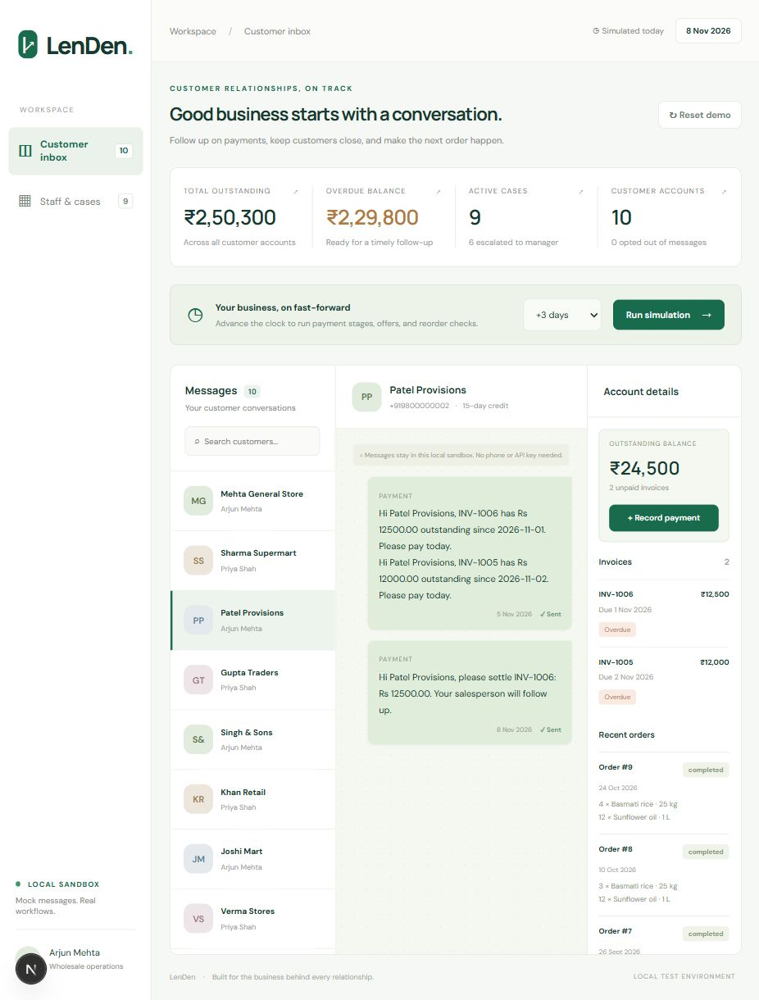

# LenDen

A local wholesale customer retention and payment follow-up simulator. Express REST API, Next.js/React customer inbox and staff workspace, PostgreSQL persistence, JSON-driven stages, and a mock message provider. No external messaging service, phone, paid account, hosted database, scheduler, or API keys.



## Start from a clean clone

Prerequisites: **Node.js 22.16+**, npm, and Docker Compose v2. Node 22 is used for compatibility with the patched Next.js and Vitest releases. Ports 5432, 4000 and 3000 must be free. Run commands from the repository root unless a `cd` is shown.

Create `.env` from `.env.example` (the defaults also work without a file):

```powershell
# Windows PowerShell
Copy-Item .env.example .env
```

```bash
# macOS / Linux
cp .env.example .env
```

Start PostgreSQL; wait until `docker compose ps` reports healthy:

```bash
docker compose up -d
docker compose ps
```

Terminal 1, backend:

```bash
cd backend
npm install
npm run migrate
npm run seed
npm run dev
```

API: http://localhost:4000. Seed always resets the fake date to **2026-11-05**, with exactly 10 customers, 20 invoices, and 30 completed orders. Seeding is destructive to this local demo database. Migrations are repeatable SQL (`CREATE ... IF NOT EXISTS`); no ORM schema generation is required.

Terminal 2, frontend:

```bash
cd frontend
npm install
npm run dev
```

Open http://localhost:3000 for the mock WhatsApp inbox and http://localhost:3000/staff for cases and notifications. The frontend reads `NEXT_PUBLIC_API_URL` from its environment or `frontend/.env.local`, defaulting to http://localhost:4000. The root `.env` is read by the backend; if you customize the public API URL, also set it in `frontend/.env.local`.

Terminal 3, tests:

```bash
cd backend
npm test
```

Tests use **`retention_test`**, never `retention`. The test setup creates the database automatically using the local Docker PostgreSQL superuser and applies the SQL migration. `TEST_DATABASE_URL` must point to a distinct database with a name ending `_test`; production URL reuse is refused. Tests are serialized because they reset their dedicated database.

Production frontend check:

```bash
cd frontend
npm run build
```

Both folders contain committed npm lockfiles. `npm ci` may replace `npm install` for reproducible installation.

## How it works

1. Every clock advance updates the date and runs the engine in one PostgreSQL transaction. `days=0` runs today without changing the date. No background scheduling or wall-clock dependence.
2. Each unpaid, unpaused invoice selects its latest eligible stage from `backend/config/stages.json`: pre-due (-2), due day (0), soft (+3), firm (+7), final (+15).
3. All eligible invoice reminders for a customer are merged into one outbox message. A database unique index enforces one outgoing message per customer per simulated day. A separate unique `(invoice_id, stage)` ledger makes stages idempotent.
4. Payments use the remaining balance. Firm reminders create salesperson cases; final reminders escalate to Manager. Open cases escalate after two simulated days. Fully settled invoices resolve their case automatically.
5. Customer commands pause reminders, notify staff, opt out, or create reorder drafts. See the walkthrough in [DEMO.md](DEMO.md).
6. Offers and reorder reminders share the daily message budget. Collection reminders have priority, then offers, then reorder reminders. Suppressed messages do not consume their eligibility.

All business mutations acquire the same transaction-scoped advisory lock, making concurrent advances, replies, resets and payments deterministic. The mock provider persists messages in the same transaction; no external delivery can happen. SQL uses parameterized queries and database constraints protect amounts and uniqueness.

## Commands and assumptions

| Reply | Effect |
| --- | --- |
| `PAID` | Notifies the salesperson to verify; **does not** change the ledger. Record the payment separately. |
| `PROMISE YYYY-MM-DD` | Pauses unpaid invoices until that date; opens waiting cases. On a broken promise, resumes at firm or a higher stage than previously sent, up to final. |
| `DISPUTE` | Pauses collections indefinitely; opens a salesperson dispute case. It can still escalate internally after two open days. |
| `STOP` | Suppresses all outgoing messages permanently until a seed reset and notifies the salesperson. |
| `YES` | Accepts the latest unanswered reorder reminder and creates one draft order. Repeated YES replies do not duplicate it. |

- Commands default to all unpaid invoices belonging to that customer; pass `invoice_id` to target one. Cases are per invoice, with no duplicates. Reorder cases are per customer/order cycle.
- A large time jump sends only the latest eligible stage, marking earlier stages superseded. It does not emit a backlog. A stage already sent cannot be sent again. After final stage exhaustion, staff case escalation remains the follow-up mechanism.
- Promises use calendar dates; reminders resume **on** the promised date. Waiting cases do not age-escalate while a promise is active. Disputes pause collection messages, not internal case escalation.
- Same-day payments do not retract messages already sent. Unsent stage eligibility is retried on a later engine run when the daily budget permits it.
- Early payment: one offer per customer, on an invoice's issue date, 2% of that invoice's original amount, valid through issue date +3 inclusive. To redeem, send `redeem_offer: true` with a payment that settles the remaining balance less the discount. Ordinary full and partial payments remain supported. Expired/used discounts cannot be applied.
- Win-back: at least 45 days since the last completed order, one offer per customer, valid through send date +7 inclusive. The configured coupon is applied once to a draft created by YES while valid. No coupon monetary value is invented because the brief does not specify one.
- Customers with any unpaid invoice at least 15 days overdue never receive offers. Offers may be eligible before that threshold, but payment-stage messages win that day's budget.
- Average reorder gap uses all completed orders and requires at least two. Drafts do not affect that history. At 90% of the gap, the last order's items are listed. Any overdue invoice suppresses reorder messaging. An unanswered reorder opens a drop-off case after two days; another two open days causes escalation.
- Every outgoing message starts as `sent`. Click its status to simulate `delivered`, then `read`; these are persistent mock statuses, not external delivery receipts.
- Calendar dates are stored as PostgreSQL DATE and returned as `YYYY-MM-DD`, avoiding timezone drift. All monetary inputs support two decimal places; calculations are rounded to cents where discounting requires it.
- This is a trusted local demo, without authentication. Reset and payment controls are deliberately available to the reviewer. No hosting or public deployment is configured.

## API

JSON bodies, JSON responses, CORS for http://localhost:3000 (override `CORS_ORIGIN` for another local UI).

| Method | Path | Body / purpose |
| --- | --- | --- |
| GET | `/health` | Liveness |
| GET | `/clock` | Current fake date |
| POST | `/clock/advance?days=7` | Integer 0-365; run engine |
| GET | `/customers` | Customer accounts and remaining balances |
| GET | `/customers/:id/messages` | Incoming and outgoing chat history |
| GET | `/customers/:id/invoices` | Invoice balances, pause state and dates |
| GET | `/customers/:id/orders` | Completed and draft orders |
| GET | `/customers/:id/offers` | Issued offers, expiry and usage |
| POST | `/payments` | `{ "invoice_id": 1, "amount": 4000 }`; optional `redeem_offer` |
| POST | `/webhook/incoming` | `{ "customer_id": 1, "text": "PROMISE 2026-11-10" }`; optional `invoice_id` |
| PATCH | `/messages/:id/status` | `{ "status": "delivered" }` or `read` |
| GET | `/cases` | Owner, status and event timeline |
| GET | `/notifications` | Staff assignments and escalations |
| GET | `/dashboard` | Outstanding, overdue and unpaid totals |
| POST | `/seed/reset` | Reset local demo state |

## Repository map

```text
backend/
  config/                 # stages.json and offers.json
  scripts/                # SQL migration runner and deterministic seed
  src/
    db/                   # pool, transaction helper and SQL migrations
    providers/            # MessageProvider, MockProvider, CloudApiProvider stub
    routes/               # Express endpoints and input validation
    services/             # clock, stage engine, cases, offers and reorder
  tests/                  # Supertest/Vitest PostgreSQL integration tests
frontend/
  app/                    # customer inbox and /staff routes
  components/             # interactive workspace
docs/screenshots/         # actual browser screenshots
```

## Verification and limitations

Verified locally: **24 PostgreSQL integration tests pass**, including the six specified scenarios; Next.js production build passes; browser walkthrough confirms combined chat reminders, account switching, a partial payment, and staff escalation timelines. npm audit reported zero known vulnerabilities after dependency updates. Browser verification used ports 3001/4001 because unrelated local apps occupied the default ports. A temporary PostgreSQL 18 instance was used because Docker was unavailable on the build machine; Docker Compose itself was not executed here. The shipped Compose service uses PostgreSQL 16 and standard compatible SQL.

Screenshots reflect the local demo in progress, not a static UI mock. External Google Fonts are optional; system sans-serif fallbacks work offline. Quiet hours, Hindi templates, real WhatsApp, authentication, hosting, and payment gateway integration are outside this implementation.

Local commits have genuine timestamps; no historical development timeline has been fabricated. Creating/publishing the public GitHub repository and confirming the assignment's actual 24-hour submission window remain the repository owner's submission steps.
